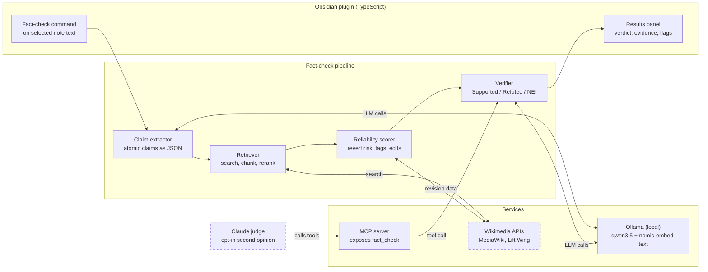

# NoteCheck

**Fact-check your Obsidian notes with a local LLM, grounded in Wikipedia.**

NoteCheck is an Obsidian plugin that extracts the factual claims from text you select, checks each one against a pinned Wikipedia revision and tells you whether the claim is supported, refuted or unverifiable. It also flags when the Wikipedia evidence itself looks unreliable. The language model runs locally through Ollama, so your notes stay on your machine unless you opt in to a Claude review.

Built by team **JAWS** for SE201 (AI-Driven Software Engineering), SMU, AY2026-27 Term 1.

> **Status:** in development for the 18 October checkpoint. See [Project status](#project-status) for what works today.

---

## Why this exists

Students pick up small factual errors while taking notes, such as a wrong date, a misattributed quote or an outdated figure. Those errors get reused in revision and assignments because checking every statement by hand takes too long, so most people skip it.

Existing Obsidian AI plugins (Copilot for Obsidian, Smart Composer, Text Generator) focus on writing and chat, and most default to cloud models. To our knowledge none of them checks a note's claims against a cited, version-pinned source or rates how reliable that source is. NoteCheck targets that gap.

**Intended users:** students and researchers who keep a knowledge base in Obsidian, and privacy-conscious users who do not want private notes sent to a cloud service by default.

## Why an LLM

The non-AI alternative is keyword search against Wikipedia plus manual lookup, or a rule-based date and number matcher. That finds related pages but cannot split a messy sentence into claims, match evidence that is worded differently or judge whether a passage contradicts the note. The LLM handles those three steps.

---

## Features

1. **Fact-check on demand.** Select text and run the command. NoteCheck extracts atomic claims, retrieves Wikipedia passages and labels each claim `Supported`, `Refuted` or `Not Enough Info`, with the evidence and a link to the exact revision used.
2. **Source reliability flags.** Each piece of evidence gets a `Low`, `Medium` or `High` badge with reasons, such as a recent unreviewed edit, a POV or Disputed tag or low citation coverage. Flags describe articles and revisions, never individual editors.
3. **MCP server.** Exposes `fact_check` and retrieval as tools so Claude can review a verdict on request. The same interface runs our evaluation harness.

Inline autocomplete (ghost text from a small local model) and an automated Claude judge are **stretch goals**, not part of the core scope.

### Worked example

Note text: *"The Treaty of Versailles was signed in 1920."*

| Claim | Verdict | Evidence and suggested fix | Reliability |
|---|---|---|---|
| Treaty of Versailles signed in 1920 | Refuted | Passage states it was signed on 28 June 1919 (revision link shown). Suggested fix: change 1920 to 1919. | High: stable article, well cited, no maintenance tags |

---

## Architecture

Everything runs on the user's machine except the Wikimedia lookups and the opt-in Claude review.



Dashed boxes are the only places data leaves the machine.

### Pipeline stages

| # | Stage | What it does | Output |
|---|---|---|---|
| 1 | Preprocess | Skips frontmatter, code blocks and LaTeX. Keeps wikilinks as context. | Clean text |
| 2 | Claim extraction | Splits text into atomic claims and filters out opinions, reminders and course-specific content that Wikipedia cannot verify. | Claims as JSON |
| 3 | Decontextualisation | Rewrites each claim to stand alone using the note title, headings and nearby sentences (for example, replacing "he" with the person's name). | Self-contained claims |
| 4 | Query generation and retrieval | Builds search queries from entities, disambiguates pages (Mercury the planet or the element), then searches, chunks and reranks passages. | Evidence passages and revision IDs |
| 5 | Reliability scoring | Scores each evidence revision with transparent rules (see below). | Badge and reasons |
| 6 | Verification | The LLM labels each claim and proposes a correction when it is refuted. | Verdict and fix |

### Reliability scoring

The scorer is rule-based on purpose, so every badge can be explained and the cost stays low. Signals come from the MediaWiki Action API and Wikimedia Lift Wing:

- Maintenance tags on the article (POV, Disputed, citation needed)
- Recent edits that nobody has reviewed yet
- Edit and revert volatility
- Revert-risk score from Lift Wing (`revertrisk-language-agnostic`)
- Citation coverage

### Techniques used

| Technique | Used for | Why |
|---|---|---|
| RAG over Wikipedia | Grounding verdicts | Small local models hallucinate. A cited passage makes each verdict checkable. |
| Structured JSON output | Claim extraction | Gives a clear unit to verify and to measure. |
| FEVER labels | Verdicts | Lets us benchmark directly. |
| Rule-based reliability scoring | Flagging weak evidence | Transparent and cheap. |
| MCP tool integration | Claude as independent reviewer | Standard protocol. Keeps the reviewer separate from the model being judged. |

---

## Tech stack

| Component | Choice |
|---|---|
| Model runtime | Ollama (local, OpenAI-compatible API) |
| Extraction and verification model | `qwen3.5:9b` (fallback `qwen3.5:4b` on 8 GB machines) |
| Embeddings | `nomic-embed-text` |
| Plugin | TypeScript, Obsidian plugin API |
| Evidence source | MediaWiki Action API, Wikimedia Lift Wing |
| MCP server | MCP TypeScript SDK |
| Baseline checker | Bespoke-MiniCheck |
| Judge and test generation | Claude (via Claude Desktop or the API) |

---

## Getting started

> **TODO (team):** confirm the commands below once the plugin scaffold is committed. File and script names are placeholders.

### Prerequisites

- [Obsidian](https://obsidian.md) with a test vault you do not mind experimenting in
- [Ollama](https://ollama.com) installed and running
- Node.js 20 or newer
- At least 16 GB RAM for `qwen3.5:9b`. Use `qwen3.5:4b` on 8 GB machines.

### 1. Pull the models

```bash
ollama pull qwen3.5:9b
ollama pull qwen3.5:4b
ollama pull nomic-embed-text
```

### 2. Build the plugin

```bash
git clone <this-repo-url>
cd notecheck
npm install
npm run build
```

### 3. Install into your vault

Copy `main.js`, `manifest.json` and `styles.css` into `<your-vault>/.obsidian/plugins/notecheck/`, then enable **NoteCheck** under Settings, Community plugins.

### 4. Configure

In the plugin settings, set the Ollama URL (default `http://localhost:11434`), pick your model and set a contact string for the Wikimedia User-Agent header (Wikimedia requires one).

### 5. Run a check

Select a sentence in any note, open the command palette and run **NoteCheck: Fact-check selection**. Results appear in the side panel.

### MCP server (optional)

```bash
# TODO: confirm path and script name
npm run mcp
```

Then add the server to Claude Desktop's MCP config so Claude can call `fact_check`. Nothing is sent to Claude unless you do this.

---

## Evaluation

We measure whether grounding in Wikipedia beats an ungrounded model, whether the cited evidence is relevant and whether the reliability flags catch bad revisions.

| Feature | Metric | Test data | Baseline | Success target |
|---|---|---|---|---|
| Fact-check verdicts | Macro-F1 over 3 labels | 300 FEVER dev claims plus 50 claims from our own notes | Qwen without RAG, Bespoke-MiniCheck | At least 10 points above the no-RAG baseline |
| Evidence quality | Share of cited passages that support the verdict (two human raters) | 50 sampled verdicts | None | 80% or higher |
| Reliability flags | Precision and recall of Low flags | 50 reverted and 50 stable revisions | Flag nothing | Both at least 0.7 |

Thresholds are tuned on a small development set first. The test set is not used for tuning.

### Planned changes after instructor feedback

These come from the review of our proposal and still need team agreement before they go in the evaluation plan:

- **Benchmark `qwen3.5:9b` early** on fact-checking or a related task before committing to it.
- **Treat FEVER as possibly contaminated.** It was published in 2017 and modern models may have trained on it, so a good score alone is weak evidence.
- **Generate extra test claims with Claude.** Take true Wikipedia facts and have Claude rewrite them as plausible falsehoods with an explanation of why each is false, in the style of MiniCheck-type datasets. The explanation also makes Claude a better judge.
- **Keep the judge and the system under test from different model families.** Claude judging Qwen is fine. The same model judging itself would not be.
- **Balance the dataset.** Report how often the checker flags true statements as well as how often it misses false ones.

---

## Project status

Checkpoint due **18 October 2026**.

| Target | State |
|---|---|
| Core feature: select text, extract claims, retrieve, show verdicts and revision links in the side panel | TODO |
| Reliability scorer: maintenance tags and recent-edit signals | TODO |
| Lift Wing revert-risk call | TODO (working or documented as stubbed) |
| MCP server exposing `fact_check` | TODO |
| First evaluation round on 50 FEVER claims with failures documented | TODO |
| Setup README and commits from every member | In progress |
| AI use disclosure log | See [`docs/ai-use-log.md`](docs/ai-use-log.md) |

Stubbed components will be listed here as they appear.

## Repository layout

> **TODO (team):** replace with the real layout once agreed. Suggested split by owner:

```
notecheck/
├── src/
│   ├── plugin/        # Obsidian UI, commands, results panel
│   ├── pipeline/      # extraction, retrieval, verification
│   ├── reliability/   # reliability scorer
│   └── mcp/           # MCP server
├── eval/              # harness, baselines, datasets, results
├── docs/
│   ├── architecture.png
│   └── ai-use-log.md
└── README.md
```

## Team

| Member | Area |
|---|---|
| Anna Aadhavan | Retrieval: Wikipedia search, disambiguation, chunking, reranking. Holds the Claude access. |
| Jonathan Ho | LLM stages: claim extraction, verification prompts, structured JSON |
| Nathanael Steven Chiang | Reliability scorer, evaluation harness and baselines |
| Medapati Williams Smith | Obsidian plugin UI and MCP server |

## Risks and responsible AI

| Risk | Mitigation |
|---|---|
| Wikipedia is not ground truth and can be vandalised or one-sided | Reliability flags, pinned revision links and evidence always shown so users can judge |
| Users over-trust verdicts | The model answers Not Enough Info rather than guessing. The UI presents verdicts as an aid, not a ruling. |
| Bias flags could unfairly label people | We score articles and revisions only. We never profile or label individual editors. |
| Notes leave the device during Claude review | Local by default. The Claude review is opt-in and clearly labelled. |
| Wikipedia content licensing | Evidence is attributed with links, as CC BY-SA requires |
| Weak hardware limits model quality | Models are configurable and we report results per model size |

## AI use disclosure

We use AI tools during development and track that use in [`docs/ai-use-log.md`](docs/ai-use-log.md), as the course requires.

## Acknowledgements

Wikipedia content is available under CC BY-SA. FEVER and MiniCheck inspire our evaluation design.
