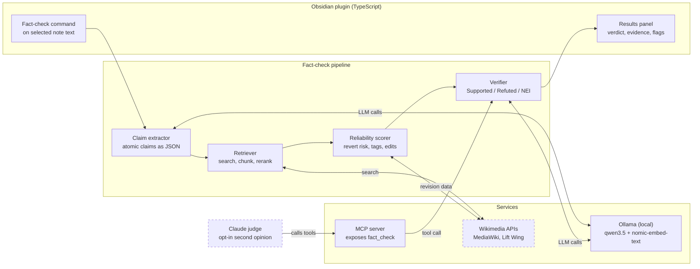

# NoteCheck

**Fact-check your Obsidian notes with a local LLM, grounded in Wikipedia.**

NoteCheck is an Obsidian plugin that extracts the factual claims from text you select, checks each one against a pinned Wikipedia revision and tells you whether the claim is supported, refuted or unverifiable. It also flags when the Wikipedia evidence itself looks unreliable. The language model runs locally through Ollama, so your notes stay on your machine unless you opt in to a Claude review.

Built by team **JAWS** for SE201 (AI-Driven Software Engineering), SMU, AY2026-27 Term 1.

> **Status:** final submission due 10 November 2026, 12:00. The core pipeline, course materials checking and live suggestions work. Ghost text and meaning selection for ambiguous names are built and tested. The remaining evaluation runs are listed in [Project status](#project-status).

---

## Why this exists

Students pick up small factual errors while taking notes, such as a wrong date, a misattributed quote or an outdated figure. Those errors get reused in revision and assignments because checking every statement by hand takes too long, so most people skip it.

Existing Obsidian AI plugins (Copilot for Obsidian, Smart Composer, Text Generator) focus on writing and chat, and most default to cloud models. To our knowledge none of them checks a note's claims against a cited, version-pinned source or rates how reliable that source is. NoteCheck targets that gap.

**Intended users:** students and researchers who keep a knowledge base in Obsidian, and privacy-conscious users who do not want private notes sent to a cloud service by default.

## Why an LLM

The non-AI alternative is keyword search against Wikipedia plus manual lookup, or a rule-based date and number matcher. That finds related pages but cannot split a messy sentence into claims, match evidence that is worded differently or judge whether a passage contradicts the note. The LLM handles those three steps.

---

## Features

1. **Fact-check on demand.** Select text and run the command. NoteCheck extracts atomic claims, retrieves Wikipedia passages and labels each claim `Supported`, `Refuted` or `Not Enough Info`, with the evidence and a link to the exact revision used.
2. **Check against your own course materials.** Point NoteCheck at a folder of lecture notes and readings. Claims are checked against that folder first, and Wikipedia is only used when the course does not cover a claim. Course-specific claims ("2NF removes partial dependencies") can now be checked too. A "course only" mode never contacts Wikipedia.
3. **Live suggestions as you type.** With live checking on, every sentence you finish is checked in the background. A wrong claim gets a wavy underline, the wrong words are struck through and the fix appears next to them, like tracked changes: "signed in ~~1920~~ **1919**". Click it to see the evidence, then Accept or Dismiss.
4. **Source reliability flags.** Each piece of Wikipedia evidence gets a `Low`, `Medium` or `High` badge with reasons, such as a recent unreviewed edit, a POV or Disputed tag or low citation coverage. Flags describe articles and revisions, never individual editors.
5. **MCP server.** Exposes `fact_check` and retrieval as tools so Claude can review a verdict on request. The same interface runs our evaluation harness.

6. **Ghost text (off by default).** A short grey suggestion from a small local model appears after the cursor when you pause after typing a space. Tab accepts it and Esc dismisses it. Turn it on with **Enable ghost text** in settings.

An automated Claude judge is a **stretch goal**, not part of the core scope.

### Where the evidence comes from

| Settings                                     | Claims are checked against                                                                                               |
| -------------------------------------------- | ------------------------------------------------------------------------------------------------------------------------ |
| No course folder (default)                   | Wikipedia only                                                                                                           |
| Course folder set                            | Your course folder first. Wikipedia when no course passage is close enough, or the course passages give Not Enough Info |
| Course folder set and **Course materials only** on | Your course folder only. Claims the course does not cover come back Not Enough Info, and Wikipedia is never contacted |

Course evidence shows "Course material" in the results and links to the heading in your note. It has no reliability badge, because the badge signals (edit history, maintenance tags) only exist for Wikipedia.

### Worked example

Note text: *"The Treaty of Versailles was signed in 1920."*

| Claim                               | Verdict | Evidence and suggested fix                                                                              | Reliability                                           |
| ----------------------------------- | ------- | ------------------------------------------------------------------------------------------------------- | ----------------------------------------------------- |
| Treaty of Versailles signed in 1920 | Refuted | Passage states it was signed on 28 June 1919 (revision link shown). Suggested fix: change 1920 to 1919. | High: stable article, well cited, no maintenance tags |

---

## How it works in plain English

Here is what happens when you select a sentence and click check, step by step.

1. **You highlight some text** in your note and run the NoteCheck command.
2. **NoteCheck cleans the text.** It ignores things that are not claims, such as code, maths and the hidden settings at the top of a note.
3. **It picks out the individual facts.** A sentence like "Einstein was born in 1879 in Ulm and won the Nobel Prize in 1921" becomes separate claims that can each be checked on their own.
4. **It throws away what can't be checked.** Opinions, to-do reminders and questions are skipped. Course-specific claims are skipped too, unless you have set a course materials folder that can check them.
5. **It rewrites each claim so it makes sense alone.** "He was born in 1879" becomes "Albert Einstein was born in 1879", because the checker will not see the rest of your note.
6. **It looks the claim up.** If you have set a course folder, it first searches your course notes, which were split into passages and indexed once when you set the folder. If they cover the claim, it skips to step 8. Otherwise it searches Wikipedia. If a search lands on a page that only lists several meanings of a name ("Mercury may refer to..."), NoteCheck reads the introduction of each meaning and keeps the one that shares the most words with your claim, so "Mercury is the closest planet to the Sun" goes to Mercury (planet). If two meanings fit about equally, it keeps both. If none fits, it keeps none rather than guessing, so a very vague claim may still need a more specific wording. It then cuts the articles into small pieces and ranks which pieces are most useful.
7. **It checks how much to trust that article.** It looks at warning banners, recent edits that nobody has reviewed and how often the page gets undone by other editors. This gives a High, Medium or Low badge with reasons.
8. **The local AI reads the evidence and decides.** It compares the Wikipedia passage with your claim and answers Supported, Refuted or Not Enough Info. If your claim is wrong, it suggests a fix.
9. **You see the result in a side panel and in your note.** Each claim shows the verdict, the exact passage, a link to the exact version of the Wikipedia page (or your course note) used and the trust badge. Refuted claims are also marked in the note itself, with the suggested change ready to accept.
10. **Optional second opinion.** If you choose to, Claude can look at a verdict through the MCP server and say whether it agrees. Nothing goes to Claude unless you set this up.

If the Wikipedia evidence is weak (the AI says Not Enough Info), NoteCheck rewrites its search and tries again, up to three more times, before giving up.

---

## Architecture

Everything runs on the user's machine except the Wikimedia lookups and the opt-in Claude review.



Dashed boxes are the only places data leaves the machine.

### Pipeline stages

| # | Stage                          | What it does                                                                                                                                 | Output                             |
| - | ------------------------------ | -------------------------------------------------------------------------------------------------------------------------------------------- | ---------------------------------- |
| 1 | Preprocess                     | Skips frontmatter, code blocks and LaTeX. Keeps wikilinks as context.                                                                        | Clean text                         |
| 2 | Claim extraction               | Splits text into atomic claims and filters out opinions, reminders and course-specific content that Wikipedia cannot verify.                 | Claims as JSON                     |
| 3 | Decontextualisation            | Rewrites each claim to stand alone using the note title, headings and nearby sentences (for example, replacing "he" with the person's name). | Self-contained claims              |
| 4 | Query generation and retrieval | Builds search queries from entities, searches, resolves disambiguation pages to the meaning the claim is about (word overlap, no model call), then chunks and reranks passages.    | Evidence passages and revision IDs |
| 5 | Reliability scoring            | Scores each evidence revision with transparent rules (see below).                                                                            | Badge and reasons                  |
| 6 | Verification                   | The LLM labels each claim and proposes a correction when it is refuted.                                                                      | Verdict and fix                    |

### Shared data format (the "claim card")

Four people are building four different parts, so the parts need to agree on what they hand to each other. Think of it as a form that every part fills in or reads. If we all agree on the form now, each person can build and test their own part with fake data, without waiting for anyone else.

Each claim travels through the system as one "claim card". Each stage adds to the card:

| Added by                    | Fields                                                                    | In plain English                                                           |
| --------------------------- | ------------------------------------------------------------------------- | -------------------------------------------------------------------------- |
| Claim extraction (Jonathan) | `claim_id`, `original_text`, `claim`                                | The fact, rewritten so it stands alone, and where it came from in the note |
| Retrieval (Aadhavan)        | `evidence[]` with `passage`, `page_title`, `revision_id`, `url` | The Wikipedia paragraphs found, and the exact page version they came from  |
| Reliability (Nathanael)     | `reliability` with `badge` and `reasons[]`                          | High, Medium or Low trust, and why                                         |
| Verification (Jonathan)     | `verdict`, `explanation`, `suggested_fix`                           | Supported, Refuted or Not Enough Info, and why                             |

Example of a finished card:

```json
{
  "claim_id": "c1",
  "original_text": "The Treaty of Versailles was signed in 1920.",
  "claim": "The Treaty of Versailles was signed in 1920.",
  "evidence": [
    {
      "passage": "The treaty was signed on 28 June 1919 ...",
      "page_title": "Treaty of Versailles",
      "revision_id": 0,
      "url": "https://en.wikipedia.org/w/index.php?oldid=0"
    }
  ],
  "reliability": { "badge": "High", "reasons": ["stable article", "well cited"] },
  "verdict": "Refuted",
  "explanation": "The passage gives the date as 28 June 1919.",
  "suggested_fix": "Change 1920 to 1919."
}
```

The `revision_id` of `0` above is a placeholder. The real format lives in `src/contract/` as a TypeScript type, plus a few example cards in `src/contract/examples/` that everyone can use as fake data.

**Rule:** changing the format affects everyone, so it only changes through a pull request that all four of us approve.

### Reliability scoring

The scorer is rule-based on purpose, so every badge can be explained and the cost stays low. Signals come from the MediaWiki Action API and Wikimedia Lift Wing:

- Maintenance tags on the article (POV, Disputed, citation needed)
- Recent edits that nobody has reviewed yet
- Edit and revert volatility
- Revert-risk score from Lift Wing (`revertrisk-language-agnostic`)
- Citation coverage

### Techniques used

| Technique                      | Used for                       | Why                                                                           |
| ------------------------------ | ------------------------------ | ----------------------------------------------------------------------------- |
| RAG over Wikipedia             | Grounding verdicts             | Small local models hallucinate. A cited passage makes each verdict checkable. |
| Structured JSON output         | Claim extraction               | Gives a clear unit to verify and to measure.                                  |
| FEVER labels                   | Verdicts                       | Lets us benchmark directly.                                                   |
| Rule-based reliability scoring | Flagging weak evidence         | Transparent and cheap.                                                        |
| MCP tool integration           | Claude as independent reviewer | Standard protocol. Keeps the reviewer separate from the model being judged.   |

---

## Tech stack

| Component                         | Choice                                                    |
| --------------------------------- | --------------------------------------------------------- |
| Model runtime                     | Ollama (local, OpenAI-compatible API)                     |
| Extraction and verification model | `qwen3.5:9b` (fallback `qwen3.5:4b` on 8 GB machines) |
| Embeddings                        | `nomic-embed-text`                                      |
| Plugin                            | TypeScript, Obsidian plugin API                           |
| Evidence source                   | MediaWiki Action API, Wikimedia Lift Wing                 |
| MCP server                        | MCP TypeScript SDK                                        |
| Baseline checker                  | Bespoke-MiniCheck                                         |
| Test claim generation (planned)   | Claude, used only to create evaluation data               |
| Development tools                 | Claude, Groq-hosted open models and Grok (in Cursor) help write and review code and tests. They are never part of the product. See [AI use disclosure](#ai-use-disclosure). |

---

## Getting started

### Prerequisites

- [Obsidian](https://obsidian.md) 1.5 or newer (desktop), with a test vault you do not mind experimenting in
- [Ollama](https://ollama.com) installed and running
- Node.js 20 or newer
- At least 16 GB RAM for `qwen3.5:9b`. Use `qwen3.5:4b` on 8 GB machines.

### 1. Pull the models

```bash
ollama pull qwen3.5:9b        # or qwen3.5:4b on 8 GB machines
ollama pull nomic-embed-text  # embeddings, for Wikipedia ranking and the course index
```

### 2. Build the plugin

```bash
git clone https://github.com/50P3D/JAWS_ObsidianCopilot.git
cd JAWS_ObsidianCopilot
npm install
npm run build
```

This writes `main.js`, `manifest.json` and `styles.css` to `dist/plugin/`.

### 3. Install into your vault

1. Create the folder `<your-vault>/.obsidian/plugins/notecheck/`.
2. Copy the three files from `dist/plugin/` into it.
3. In Obsidian, open **Settings → Community plugins**, turn off Restricted mode if asked, and enable **NoteCheck**.

After every rebuild, copy the files again and either restart Obsidian or toggle NoteCheck off and on.

### 4. Configure

Open **Settings → NoteCheck**:

| Setting                      | What to enter                                                                                                    |
| ---------------------------- | ---------------------------------------------------------------------------------------------------------------- |
| Ollama URL                   | `http://localhost:11434` unless you changed Ollama's port                                                        |
| Model name                   | A model you have pulled, for example `qwen3.5:9b`. It must match `ollama list` exactly.                          |
| Wikimedia User-Agent         | `NoteCheck/0.1 (your-email@example.com)`. Wikimedia asks every client for a contact.                             |
| Enable live fact-checking    | On to get suggestions as you type (see below)                                                                   |
| Live check debounce (ms)     | How long to wait after you stop typing. 1500 is a good start.                                                    |
| Course materials folder      | Vault path of your course folder, for example `Courses/SE201`. Empty means Wikipedia only.                       |
| Course materials only        | On to never contact Wikipedia                                                                                    |
| Enable ghost text            | On to get a grey word suggestion after you pause (off by default)                                                |
| Ghost text model             | A small, fast model you have pulled, for example `qwen3.5:2b`. Separate from the model above. Empty means no suggestions. |
| Ghost text delay (ms)        | How long to wait after you stop typing before asking for a suggestion                                            |

**Enable Claude review** appears in settings but does not do anything yet. Claude reviews verdicts through the MCP server instead (see [Features](#features)).

---

## Using NoteCheck

### Check a selection

1. Select one or more sentences in a note.
2. Open the command palette (`Ctrl/Cmd+P`) and run **NoteCheck: Fact-check selection**.
3. The results panel opens on the right. Each claim shows its verdict, explanation, evidence (with a link to the Wikipedia revision or your course note) and, for Wikipedia evidence, a reliability badge.
4. Refuted claims are also marked in the note itself (see the next section). **Apply fix** in the panel changes only the wrong words in your sentence.

The magnifying-glass icon in the left ribbon reopens the results panel.

### Live suggestions as you type

Turn on **Enable live fact-checking**, then write as normal.

- When you pause, NoteCheck checks the sentences you have **finished** in the current section. A sentence counts as finished when it ends in `.`, `!` or `?`. A bullet without a full stop counts once your cursor leaves its line. The sentence you are still typing is left alone.
- A badge in the bottom right of the editor shows `NoteCheck: Checking 1 sentence…`, then the number of suggestions.
- A wrong claim gets a **wavy red underline**. The wrong words are **struck through** and the suggested words appear **in green** right after them.
- **Click** the underline or the green text to open a card with the explanation, the evidence passage and a link to its source. **Accept** applies the change. **Dismiss** hides it for good.
- **Keyboard:** run **NoteCheck: Accept suggestion at cursor** with the cursor in the sentence. You can bind it to a hotkey under Settings → Hotkeys.
- Sometimes the fix rewords the whole sentence and cannot be placed word by word. Then a small red **check** chip appears instead, and its card offers **Copy wording**.
- Each sentence is checked once. Its result is remembered by its text, so earlier sentences are not checked again. If you edit a sentence, its suggestion disappears and the new wording is checked.

Expect each new sentence to take roughly 10 to 60 seconds on a laptop with the 9B model, and less with the 4B model or course-only mode.

### Check against your course materials

1. Put your course materials in a vault folder as markdown, one file per lecture or reading. Headings help, because each passage is labelled with the heading above it.
2. Set **Course materials folder** to that folder and click **Index now**, or run **NoteCheck: Index course materials**. The notice shows how many passages were indexed.
3. Check notes as usual. Course evidence is marked "Course material", and its link jumps to the heading in your course note.

The index updates itself before each check. Only files that changed since the last check are re-embedded. It is saved in the plugin folder (`.obsidian/plugins/notecheck/course-index.json`), not among your notes. The note being checked is always left out of the search, so a note in the course folder can never confirm itself.

> Put the **source material** (slides, lecture notes from the lecturer, readings) in the course folder, not the notes you want checked. Otherwise NoteCheck checks your notes against themselves.

### MCP server (optional)

```bash
npm run mcp
```

Add the server to Claude Desktop's config (`%APPDATA%\Claude\claude_desktop_config.json` on Windows, `~/Library/Application Support/Claude/claude_desktop_config.json` on macOS). The `env` line is optional and adds course checking:

```json
{
  "mcpServers": {
    "notecheck": {
      "command": "npx",
      "args": ["tsx", "<path-to-repo>/src/mcp/index.ts"],
      "env": { "NOTECHECK_COURSE_DIR": "<path-to-course-folder>" }
    }
  }
}
```

Nothing is sent to Claude unless you do this. See [`src/mcp/README.md`](src/mcp/README.md) for details.

---

## Testing it yourself

Work through these in order. Parts A and B run without Obsidian. Part C is the hands-on check in Obsidian.

### A. Automated tests (no Ollama needed)

```bash
npm run typecheck          # no output means no type errors
npm run test:plugin        # 21 tests: inline suggestions, word-level fixes, sentence splitting
npm run test:course        # 11 tests: course chunking, indexing, search
npm run test:llm           # 9 tests: note preprocessing, extraction prompt
npm test                   # 28 tests: retrieval
npm run test:reliability   # 53 tests
npm run test:eval          # 27 tests
```

Every suite should end with `# fail 0`.

### B. Pipeline smoke tests (needs Ollama)

Start Ollama, then run the course smoke test. It indexes the sample course in [`src/course/testdata/sample-course/`](src/course/testdata/sample-course/) and checks three claims.

```bash
# bash / macOS / Linux
OLLAMA_MODEL=qwen3.5:9b npm run smoke:course
```

```powershell
# Windows PowerShell
$env:OLLAMA_MODEL="qwen3.5:9b"; npm run smoke:course
```

Expected, give or take wording:

| Claim                                              | Verdict   | Evidence                                  |
| -------------------------------------------------- | --------- | ----------------------------------------- |
| Second normal form removes transitive dependencies | Refuted   | course: Week 3 - Normalisation, § 3NF and § 2NF |
| Read Committed prevents dirty reads                | Supported | course: Week 5 - Transactions             |
| The Treaty of Versailles was signed in 1920        | Refuted   | wikipedia: Treaty of Versailles           |

Run it a second time. The first line should say `0 file(s) embedded`, which shows unchanged files are not embedded again. `npm run smoke:pipeline` runs the Wikipedia-only pipeline. To try your own course folder, set `NOTECHECK_COURSE_DIR` to it.

### C. Hands-on checks in Obsidian

**Setup**

1. Build and install the plugin (Getting started, steps 2 and 3) into a **test vault**.
2. Copy the folder `src/course/testdata/sample-course` into the vault as `Courses/Databases`.
3. In NoteCheck's settings, set the model, the Wikimedia User-Agent, **Course materials folder** = `Courses/Databases`, and turn on **Enable live fact-checking**.
4. Open the developer console (`Ctrl+Shift+I` on Windows/Linux, `Cmd+Option+I` on macOS). NoteCheck logs lines starting with `[NoteCheck Live]` and `[NoteCheck course]`, which help when something looks wrong.
5. Create a new note called `Test` **outside** the course folder.

**Checks.** Type each sentence on its own line, then wait for the status badge to finish.

| #  | Do this                                                                                                     | Expect                                                                                                                                                      |
| -- | ----------------------------------------------------------------------------------------------------------- | ----------------------------------------------------------------------------------------------------------------------------------------------------------- |
| 1  | Click **Index now** in settings                                                                             | Notice: "Course index has 10 passages"                                                                                                                       |
| 2  | Type `The Treaty of Versailles was signed in 1920.`                                                          | Badge shows "Checking 1 sentence…", then the sentence is underlined, `1920` is struck through and a green `1919` appears                                     |
| 3  | Type `The Eiffel Tower is in Berlin` and keep typing more words without a full stop                          | Nothing is checked yet. Type the full stop and pause: now it is checked                                                                                       |
| 4  | Click the green `1919`                                                                                       | Card shows "Refuted by Wikipedia", `1920 → 1919`, the explanation, a passage and a link to the Wikipedia revision                                             |
| 5  | Click **Accept**                                                                                             | Only `1920` changes to `1919`. The underline goes, and the sentence is not checked again (the badge does not show "Checking")                                 |
| 6  | Type `Second normal form removes transitive dependencies.`                                                   | `Second` struck through, green `Third`. The card says "by your course notes", and its link opens *Week 3 - Normalisation* at the 3NF heading                  |
| 7  | Under a heading `# Albert Einstein`, type `He was born in 1880 in Ulm.`                                      | Only `1880` → `1879` is suggested. Accepting keeps "He"                                                                                                       |
| 8  | With a suggestion showing, type a new sentence **above** it                                                  | The suggestion stays on the same words                                                                                                                        |
| 9  | Edit a word inside a suggested sentence                                                                      | That suggestion disappears, and the new wording is checked after the pause                                                                                    |
| 10 | Open a suggestion card and click **Dismiss**, then type elsewhere in the section                             | The dismissed suggestion does not come back                                                                                                                   |
| 11 | Put the cursor in a suggested sentence and run **NoteCheck: Accept suggestion at cursor**                     | Same result as clicking Accept                                                                                                                                |
| 12 | Turn live checking off. Select `The Eiffel Tower is in Berlin.` and run **NoteCheck: Fact-check selection**   | The results panel lists the claim as Refuted with Wikipedia evidence, the same inline suggestion appears in the note, and **Apply fix** changes only the wrong word |
| 13 | Turn on **Course materials only**, select `The Treaty of Versailles was signed in 1919.` and run **Fact-check selection** | The panel shows Not Enough Info: "Your course materials do not cover this claim". It is fast, because Wikipedia is not searched. Turn the setting off again afterwards |
| 14 | Add a line to *Week 5 - Transactions*, then run a selection check                                            | Console shows `[NoteCheck course] indexed Courses/Databases/Week 5 - Transactions.md`, and no other file                                                      |
| 15 | Inside `Courses/Databases`, create a note with `Read Committed prevents phantom reads.` and check it          | Refuted by *Week 5 - Transactions*, never Supported by the note itself                                                                                        |
| 16 | Turn live checking back on, quit Ollama and type a new sentence                                               | Badge shows "Check failed" and Obsidian keeps working. Start Ollama again: after your next edit the sentence is checked                                         |

If something fails, write down the test number, the console output and the model you used before you report it.

---

## Evaluation

We measure whether grounding in Wikipedia beats an ungrounded model, whether the cited evidence is relevant and whether the reliability flags catch bad revisions.

| Feature             | Metric                                                              | Test data                                              | Baseline                            | Success target                               |
| ------------------- | ------------------------------------------------------------------- | ------------------------------------------------------ | ----------------------------------- | -------------------------------------------- |
| Fact-check verdicts | Macro-F1 over 3 labels                                              | 300 FEVER dev claims plus 50 claims from our own notes | Qwen without RAG, Bespoke-MiniCheck | At least 10 points above the no-RAG baseline |
| Evidence quality    | Share of cited passages that support the verdict (two human raters) | 50 sampled verdicts                                    | None                                | 80% or higher                                |
| Reliability flags   | Precision and recall of Low flags                                   | 50 reverted and 50 stable revisions                    | Flag nothing                        | Both at least 0.7                            |

Thresholds are tuned on a small development set first. The test set is not used for tuning.

### Planned changes after instructor feedback

These come from the review of our proposal. The orchestrator with retry and the claim card contract are built. Which of the rest are done is tracked in [Project status](#project-status). The owners below are proposed and the team should confirm them.

| Step                                                                   | In plain English                                                                                                                                                                | Owner                           | Where it lives             |
| ---------------------------------------------------------------------- | ------------------------------------------------------------------------------------------------------------------------------------------------------------------------------- | ------------------------------- | -------------------------- |
| Benchmark `qwen3.5:9b` early                                         | Before building everything on this model, test whether it can actually do fact-checking. Compare it with `qwen3.5:4b`.                                                        | Jonathan                        | `src/llm/benchmarks/`    |
| Treat FEVER as possibly contaminated                                   | FEVER dates from 2017, so the model may have seen the answers in training. A good score alone proves little, so write this limit down in the results.                           | Nathanael                       | `eval/`                  |
| Generate extra test claims with Claude                                 | Take true Wikipedia facts and ask Claude to rewrite each as a believable falsehood, plus a note on why it is false. This is how modern fact-checking test sets are often built. | Aadhavan                        | `tools/claim-generator/` |
| Check the generated claims                                             | Spot check a sample by hand so we do not trust bad test data.                                                                                                                   | Nathanael                       | `eval/`                  |
| Keep the judge and the system under test from different model families | Claude judging Qwen is fine. The same model marking its own work is not.                                                                                                        | Nathanael                       | `eval/`                  |
| Balance the dataset                                                    | Use about as many true claims as false ones. Report how often the checker wrongly flags true statements as well as how often it misses false ones.                              | Nathanael                       | `eval/`                  |
| Tune on a dev set, test once                                           | Adjust thresholds on a small practice set. Run the final test set only at the end.                                                                                              | Nathanael                       | `eval/`                  |
| Orchestrator with retry                                                | The small controller that runs the steps in order and retries the search when evidence is weak.                                                                                 | Jonathan                        | `src/orchestrator/`      |
| Interface contract (claim card)                                        | The shared form every part reads and writes.                                                                                                                                    | Whole team, drafted by Aadhavan | `src/contract/`          |

Retrieval choices (keyword, embeddings or hybrid) stay with Aadhavan, who should record the decision and the comparison in `src/retrieval/NOTES.md`.

---

## Project status

Checkpoint due **18 October 2026**.

| Target                                                                                                  | State                                                  |
| ------------------------------------------------------------------------------------------------------- | ------------------------------------------------------ |
| Core feature: select text, extract claims, retrieve, show verdicts and revision links in the side panel | **Done** — plugin wired to real orchestrator    |
| Reliability scorer: maintenance tags and recent-edit signals                                            | **Done** — merged into pipeline, 53 tests pass  |
| Lift Wing revert-risk call                                                                              | **Done** — live, can be toggled off             |
| MCP server exposing `fact_check`                                                                      | **Done** — wired to real pipeline               |
| First evaluation round on 50 FEVER claims with failures documented                                      | **Done** — no-RAG baseline run (macro-F1 0.429) |
| Setup README and commits from every member                                                              | **Done**                                         |
| AI use disclosure log                                                                                   | See [`docs/ai-use-log.md`](docs/ai-use-log.md)        |

**After the checkpoint (instructor feedback)**

| Target                                                                | State                                                                                       |
| --------------------------------------------------------------------- | ------------------------------------------------------------------------------------------- |
| RAG over the user's course materials, with Wikipedia as fallback      | **Done** — `src/course/`, 11 tests, live smoke test passes. Score threshold not tuned yet |
| Cache Wikipedia articles and passage embeddings between checks        | **Done** — 1 hour article cache, embedding cache                                          |
| Live checking with inline, word-level suggestions                     | **Done** — 21 tests. Needs the hands-on checks in [Testing it yourself](#testing-it-yourself) |
| Ghost text (grey inline autocomplete, Tab to accept)                  | **Done** — 120 tests, mutation score 86.96% (Stryker, three review rounds). Hands-on check in Obsidian still to do |
| Choosing between meanings of an ambiguous name                        | **Done** — 59 tests, mutation score 98.53% (Stryker, two passes), live smoke test on Mercury passes. Chooses by word overlap only, weights set by hand |
| Course RAG evaluation on our own notes, per model size                | Not started                                                                                 |
| Prefix caching, multi-session, Ollama keep-alive settings             | Not started                                                                                 |

**Evaluation still to run before submission**

| Target                                                                | State                                                       |
| --------------------------------------------------------------------- | ----------------------------------------------------------- |
| Verdicts with RAG against the no-RAG baseline on FEVER dev            | Not run yet (the no-RAG baseline is done)                   |
| Bespoke-MiniCheck baseline                                            | Built, not run yet                                          |
| Held-out test run (once, after thresholds are fixed on dev)           | Not run yet                                                 |
| Evidence quality rating by two people                                 | Not done                                                    |
| Claims from our own notes, labelled and split into dev and test       | Not done                                                    |
| Claude-generated false claims (`tools/claim-generator/`)              | Not done                                                    |

Stubbed components will be listed here as they appear.

## Repository layout

Each person owns their own folders. You only edit files in your own folders. Everything else is read only for you, unless you go through a pull request.

```
notecheck/
├── src/
│   ├── retrieval/       # Aadhavan: Wikipedia search, disambiguation, chunking, reranking
│   ├── llm/             # Jonathan: claim extraction, verification prompts, model benchmarks
│   ├── orchestrator/    # Jonathan: runs the steps in order, retries weak searches
│   ├── reliability/     # Nathanael: trust badge scoring
│   ├── course/          # Medapati (proposed): index and search the user's course materials
│   ├── plugin/          # Medapati: Obsidian UI, commands, results panel, live suggestions
│   ├── mcp/             # Medapati: MCP server
│   └── contract/        # Shared: the claim card format and example cards (changes need all four approvals)
├── eval/                # Nathanael: harness, baselines, datasets, results
├── tools/
│   └── claim-generator/ # Aadhavan: Claude-generated test claims
├── docs/                # Shared: architecture.png, ai-use-log.md (see rules below)
├── .github/CODEOWNERS   # Tells GitHub who must review each folder
└── README.md            # Shared: changes through a pull request
```

---

## Working together

Separate folders stop most conflicts before they start. These habits handle the rest.

**Folders**

- Edit only your own folders. If you need a change in someone else's folder, ask them or open a pull request that they approve.
- The shared files are `src/contract/`, `README.md`, `package.json`, `package-lock.json` and `docs/`. Tell the group chat before you change one, and keep the change small.

**Branches and pull requests**

- Never push straight to `main`. Make a branch for each task, named `yourname/what-it-does` (for example `aadhavan/hybrid-search`).
- Open a pull request when the task works. One teammate reads it before it merges. A change to a shared file needs a review from the owner of the part it affects.
- Keep pull requests small. A change that touches ten files is hard to review and easy to break.
- Delete the branch after merging.

**Staying in sync**

- Pull the latest `main` before you start work each day and before you open a pull request.
- Commit small and often, with a message that says what changed and why ("Add disambiguation for ambiguous page titles", not "fix stuff").
- Commit under your own name and email. The checkpoint checks that every member has commits.
- If two people end up editing the same file, stop and talk before either of you merges. Do not fix a merge conflict by guessing.

**Keep the repo clean**

- Never commit secrets such as API keys or `.env` files. Put them in `.env` and keep it in `.gitignore`. Rotate any key that slips through.
- Do not commit large files such as model weights or full datasets. Commit a small sample and a script or note that explains how to download the rest.
- Do not commit built output (`main.js` from a build, `node_modules/`). Add them to `.gitignore`.
- Run the build and tests before you push, so `main` always works.

**Fake data until the real thing arrives**

- Build against the example cards in `src/contract/examples/`. If your part depends on someone else's, use fake data and list the part as stubbed in the status table.

## Team

| Member                  | Area                                                                                       |
| ----------------------- | ------------------------------------------------------------------------------------------ |
| Anna Aadhavan           | Retrieval: Wikipedia search, disambiguation, chunking, reranking. Holds the Claude access. |
| Jonathan Ho             | LLM stages: claim extraction, verification prompts, structured JSON                        |
| Nathanael Steven Chiang | Reliability scorer, evaluation harness and baselines                                       |
| Medapati Williams Smith | Obsidian plugin UI and MCP server                                                          |

## Risks and responsible AI

| Risk                                                             | Mitigation                                                                                                |
| ---------------------------------------------------------------- | --------------------------------------------------------------------------------------------------------- |
| Wikipedia is not ground truth and can be vandalised or one-sided | Reliability flags, pinned revision links and evidence always shown so users can judge                     |
| Users over-trust verdicts                                        | The model answers Not Enough Info rather than guessing. The UI presents verdicts as an aid, not a ruling. |
| Bias flags could unfairly label people                           | We score articles and revisions only. We never profile or label individual editors.                       |
| Notes leave the device during Claude review                      | Local by default. The Claude review is opt-in and clearly labelled.                                       |
| Wikipedia content licensing                                      | Evidence is attributed with links, as CC BY-SA requires                                                   |
| Weak hardware limits model quality                               | Models are configurable and we report results per model size                                              |
| The local model gets a verdict or an explanation wrong           | Every verdict shows its evidence and revision link. Not Enough Info is allowed. Results are measured against FEVER labels and a no-RAG baseline |
| Text in a Wikipedia page or a note tries to steer the model      | The model only returns a label, an explanation and a fix. It has no tools and cannot change files. Edits happen only when the user clicks Accept or Tab |
| AI-written code hides bugs or weak tests                         | Tests are written first. Mutation testing (Stryker) checks that tests fail when code is broken. A second model from a different family reviews the code and tests, and a teammate approves every pull request |
| Ghost text inserts a wrong or odd suggestion                     | Off by default. Local model only. Nothing is written until the user presses Tab. It is skipped inside code, headings, tables and frontmatter |

## AI use disclosure

We use AI tools during development and track that use in [`docs/ai-use-log.md`](docs/ai-use-log.md), as the course requires. Each member also keeps a short note about their own work in their `NAME.md` file at the repository root.

- **In the product:** only local models run through Ollama (Qwen for claims and verdicts, a small Qwen for ghost text, `nomic-embed-text` for embeddings). Claude is used only if a user opts in to the Claude review.
- **During development:** Claude, Groq-hosted open models and Grok in Cursor help write code, tests and reviews. They are development tools only. They never run inside the product and never score our final results.
- **Planned uses still to be logged when they happen:** generating false claims for evaluation data, a reviewer model that judges our verdicts (from a different model family than the one being judged), and any data used for fine-tuning.
- **Checks on AI-written code:** tests first, mutation testing, review by a second model, and a teammate's approval on each pull request.

## Acknowledgements

Wikipedia content is available under CC BY-SA. FEVER and MiniCheck inspire our evaluation design.
