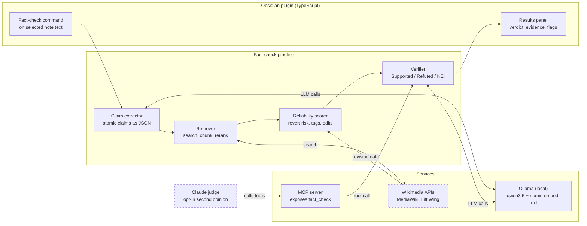

# NoteCheck

**Fact-check your Obsidian notes with a local LLM, grounded in Wikipedia.**

NoteCheck is an Obsidian plugin that extracts the factual claims from text you select, checks each one against a pinned Wikipedia revision and tells you whether the claim is supported, refuted or unverifiable. It also flags when the Wikipedia evidence itself looks unreliable. The language model runs locally through Ollama, so your notes stay on your machine unless you opt in to a Claude review.

Built by team **JAWS** for SE201 (AI-Driven Software Engineering), SMU, AY2026-27 Term 1.

> **Status:** in development for the 18 October checkpoint. See [Project status](#project-status) for what works today.

---

## Why this exists

Students pick up small factual errors while taking notes, such as a wrong date, a misattributed quote or an outdated figure. Those errors get reused in revision and assignments because checking every statement by hand takes too long, so most people skip it.

Existing Obsidian AI plugins (Copilot for Obsidian, Smart Composer, Text Generator) focus on writing and chat, and most default to cloud models. To our knowledge none of them checks a note's claims against a cited, version-pinned source or rates how reliable that source is. NoteCheck targets that gap.

**Intended users:** students and researchers who keep a knowledge base in Obsidian, and privacy-conscious users who do not want private notes sent to a cloud service by default.

## Why an LLM

The non-AI alternative is keyword search against Wikipedia plus manual lookup, or a rule-based date and number matcher. That finds related pages but cannot split a messy sentence into claims, match evidence that is worded differently or judge whether a passage contradicts the note. The LLM handles those three steps.

---

## Features

1. **Fact-check on demand.** Select text and run the command. NoteCheck extracts atomic claims, retrieves Wikipedia passages and labels each claim `Supported`, `Refuted` or `Not Enough Info`, with the evidence and a link to the exact revision used.
2. **Source reliability flags.** Each piece of evidence gets a `Low`, `Medium` or `High` badge with reasons, such as a recent unreviewed edit, a POV or Disputed tag or low citation coverage. Flags describe articles and revisions, never individual editors.
3. **MCP server.** Exposes `fact_check` and retrieval as tools so Claude can review a verdict on request. The same interface runs our evaluation harness.

Inline autocomplete (ghost text from a small local model) and an automated Claude judge are **stretch goals**, not part of the core scope.

### Worked example

Note text: *"The Treaty of Versailles was signed in 1920."*

| Claim | Verdict | Evidence and suggested fix | Reliability |
|---|---|---|---|
| Treaty of Versailles signed in 1920 | Refuted | Passage states it was signed on 28 June 1919 (revision link shown). Suggested fix: change 1920 to 1919. | High: stable article, well cited, no maintenance tags |

---

## How it works in plain English

Here is what happens when you select a sentence and click check, step by step.

1. **You highlight some text** in your note and run the NoteCheck command.
2. **NoteCheck cleans the text.** It ignores things that are not claims, such as code, maths and the hidden settings at the top of a note.
3. **It picks out the individual facts.** A sentence like "Einstein was born in 1879 in Ulm and won the Nobel Prize in 1921" becomes separate claims that can each be checked on their own.
4. **It throws away what can't be checked.** Opinions, to-do reminders and things only your lecturer said can't be proven from Wikipedia, so they are skipped.
5. **It rewrites each claim so it makes sense alone.** "He was born in 1879" becomes "Albert Einstein was born in 1879", because the checker will not see the rest of your note.
6. **It looks the claim up on Wikipedia.** It searches, picks the right article when a name has several meanings (Mercury the planet or the metal), cuts the article into small pieces and ranks which pieces are most useful.
7. **It checks how much to trust that article.** It looks at warning banners, recent edits that nobody has reviewed and how often the page gets undone by other editors. This gives a High, Medium or Low badge with reasons.
8. **The local AI reads the evidence and decides.** It compares the Wikipedia passage with your claim and answers Supported, Refuted or Not Enough Info. If your claim is wrong, it suggests a fix.
9. **You see the result in a side panel.** Each claim shows the verdict, the exact passage, a link to the exact version of the Wikipedia page used and the trust badge.
10. **Optional second opinion.** If you choose to, Claude can look at a verdict through the MCP server and say whether it agrees. Nothing goes to Claude unless you set this up.

Planned extra step: if the evidence is weak (the AI says Not Enough Info), NoteCheck rewrites its search and tries again, up to two more times, before giving up.

---

## Architecture

Everything runs on the user's machine except the Wikimedia lookups and the opt-in Claude review.



Dashed boxes are the only places data leaves the machine.

### Pipeline stages

| # | Stage | What it does | Output |
|---|---|---|---|
| 1 | Preprocess | Skips frontmatter, code blocks and LaTeX. Keeps wikilinks as context. | Clean text |
| 2 | Claim extraction | Splits text into atomic claims and filters out opinions, reminders and course-specific content that Wikipedia cannot verify. | Claims as JSON |
| 3 | Decontextualisation | Rewrites each claim to stand alone using the note title, headings and nearby sentences (for example, replacing "he" with the person's name). | Self-contained claims |
| 4 | Query generation and retrieval | Builds search queries from entities, disambiguates pages (Mercury the planet or the element), then searches, chunks and reranks passages. | Evidence passages and revision IDs |
| 5 | Reliability scoring | Scores each evidence revision with transparent rules (see below). | Badge and reasons |
| 6 | Verification | The LLM labels each claim and proposes a correction when it is refuted. | Verdict and fix |

### Shared data format (the "claim card")

Four people are building four different parts, so the parts need to agree on what they hand to each other. Think of it as a form that every part fills in or reads. If we all agree on the form now, each person can build and test their own part with fake data, without waiting for anyone else.

Each claim travels through the system as one "claim card". Each stage adds to the card:

| Added by | Fields | In plain English |
|---|---|---|
| Claim extraction (Jonathan) | `claim_id`, `original_text`, `claim` | The fact, rewritten so it stands alone, and where it came from in the note |
| Retrieval (Aadhavan) | `evidence[]` with `passage`, `page_title`, `revision_id`, `url` | The Wikipedia paragraphs found, and the exact page version they came from |
| Reliability (Nathanael) | `reliability` with `badge` and `reasons[]` | High, Medium or Low trust, and why |
| Verification (Jonathan) | `verdict`, `explanation`, `suggested_fix` | Supported, Refuted or Not Enough Info, and why |

Example of a finished card:

```json
{
  "claim_id": "c1",
  "original_text": "The Treaty of Versailles was signed in 1920.",
  "claim": "The Treaty of Versailles was signed in 1920.",
  "evidence": [
    {
      "passage": "The treaty was signed on 28 June 1919 ...",
      "page_title": "Treaty of Versailles",
      "revision_id": 0,
      "url": "https://en.wikipedia.org/w/index.php?oldid=0"
    }
  ],
  "reliability": { "badge": "High", "reasons": ["stable article", "well cited"] },
  "verdict": "Refuted",
  "explanation": "The passage gives the date as 28 June 1919.",
  "suggested_fix": "Change 1920 to 1919."
}
```

The `revision_id` of `0` above is a placeholder. The real format lives in `src/contract/` as a TypeScript type, plus a few example cards in `src/contract/examples/` that everyone can use as fake data.

**Rule:** changing the format affects everyone, so it only changes through a pull request that all four of us approve.

### Reliability scoring

The scorer is rule-based on purpose, so every badge can be explained and the cost stays low. Signals come from the MediaWiki Action API and Wikimedia Lift Wing:

- Maintenance tags on the article (POV, Disputed, citation needed)
- Recent edits that nobody has reviewed yet
- Edit and revert volatility
- Revert-risk score from Lift Wing (`revertrisk-language-agnostic`)
- Citation coverage

### Techniques used

| Technique | Used for | Why |
|---|---|---|
| RAG over Wikipedia | Grounding verdicts | Small local models hallucinate. A cited passage makes each verdict checkable. |
| Structured JSON output | Claim extraction | Gives a clear unit to verify and to measure. |
| FEVER labels | Verdicts | Lets us benchmark directly. |
| Rule-based reliability scoring | Flagging weak evidence | Transparent and cheap. |
| MCP tool integration | Claude as independent reviewer | Standard protocol. Keeps the reviewer separate from the model being judged. |

---

## Tech stack

| Component | Choice |
|---|---|
| Model runtime | Ollama (local, OpenAI-compatible API) |
| Extraction and verification model | `qwen3.5:9b` (fallback `qwen3.5:4b` on 8 GB machines) |
| Embeddings | `nomic-embed-text` |
| Plugin | TypeScript, Obsidian plugin API |
| Evidence source | MediaWiki Action API, Wikimedia Lift Wing |
| MCP server | MCP TypeScript SDK |
| Baseline checker | Bespoke-MiniCheck |
| Judge and test generation | Claude (via Claude Desktop or the API) |

---

## Getting started

> **TODO (team):** confirm the commands below once the plugin scaffold is committed. File and script names are placeholders.

### Prerequisites

- [Obsidian](https://obsidian.md) with a test vault you do not mind experimenting in
- [Ollama](https://ollama.com) installed and running
- Node.js 20 or newer
- At least 16 GB RAM for `qwen3.5:9b`. Use `qwen3.5:4b` on 8 GB machines.

### 1. Pull the models

```bash
ollama pull qwen3.5:9b
ollama pull qwen3.5:4b
ollama pull nomic-embed-text
```

### 2. Build the plugin

```bash
git clone <this-repo-url>
cd notecheck
npm install
npm run build
```

### 3. Install into your vault

Copy `main.js`, `manifest.json` and `styles.css` into `<your-vault>/.obsidian/plugins/notecheck/`, then enable **NoteCheck** under Settings, Community plugins.

### 4. Configure

In the plugin settings, set the Ollama URL (default `http://localhost:11434`), pick your model and set a contact string for the Wikimedia User-Agent header (Wikimedia requires one).

### 5. Run a check

Select a sentence in any note, open the command palette and run **NoteCheck: Fact-check selection**. Results appear in the side panel.

### MCP server (optional)

```bash
# TODO: confirm path and script name
npm run mcp
```

Then add the server to Claude Desktop's MCP config so Claude can call `fact_check`. Nothing is sent to Claude unless you do this.

---

## Evaluation

We measure whether grounding in Wikipedia beats an ungrounded model, whether the cited evidence is relevant and whether the reliability flags catch bad revisions.

| Feature | Metric | Test data | Baseline | Success target |
|---|---|---|---|---|
| Fact-check verdicts | Macro-F1 over 3 labels | 300 FEVER dev claims plus 50 claims from our own notes | Qwen without RAG, Bespoke-MiniCheck | At least 10 points above the no-RAG baseline |
| Evidence quality | Share of cited passages that support the verdict (two human raters) | 50 sampled verdicts | None | 80% or higher |
| Reliability flags | Precision and recall of Low flags | 50 reverted and 50 stable revisions | Flag nothing | Both at least 0.7 |

Thresholds are tuned on a small development set first. The test set is not used for tuning.

### Planned changes after instructor feedback

These come from the review of our proposal. The owners below are proposed and the team should confirm them.

| Step | In plain English | Owner | Where it lives |
|---|---|---|---|
| Benchmark `qwen3.5:9b` early | Before building everything on this model, test whether it can actually do fact-checking. Compare it with `qwen3.5:4b`. | Jonathan | `src/llm/benchmarks/` |
| Treat FEVER as possibly contaminated | FEVER dates from 2017, so the model may have seen the answers in training. A good score alone proves little, so write this limit down in the results. | Nathanael | `eval/` |
| Generate extra test claims with Claude | Take true Wikipedia facts and ask Claude to rewrite each as a believable falsehood, plus a note on why it is false. This is how modern fact-checking test sets are often built. | Aadhavan | `tools/claim-generator/` |
| Check the generated claims | Spot check a sample by hand so we do not trust bad test data. | Nathanael | `eval/` |
| Keep the judge and the system under test from different model families | Claude judging Qwen is fine. The same model marking its own work is not. | Nathanael | `eval/` |
| Balance the dataset | Use about as many true claims as false ones. Report how often the checker wrongly flags true statements as well as how often it misses false ones. | Nathanael | `eval/` |
| Tune on a dev set, test once | Adjust thresholds on a small practice set. Run the final test set only at the end. | Nathanael | `eval/` |
| Orchestrator with retry | The small controller that runs the steps in order and retries the search when evidence is weak. | Jonathan | `src/orchestrator/` |
| Interface contract (claim card) | The shared form every part reads and writes. | Whole team, drafted by Aadhavan | `src/contract/` |

Retrieval choices (keyword, embeddings or hybrid) stay with Aadhavan, who should record the decision and the comparison in `src/retrieval/NOTES.md`.

---

## Project status

Checkpoint due **18 October 2026**.

| Target | State |
|---|---|
| Core feature: select text, extract claims, retrieve, show verdicts and revision links in the side panel | TODO |
| Reliability scorer: maintenance tags and recent-edit signals | TODO |
| Lift Wing revert-risk call | TODO (working or documented as stubbed) |
| MCP server exposing `fact_check` | TODO |
| First evaluation round on 50 FEVER claims with failures documented | TODO |
| Setup README and commits from every member | In progress |
| AI use disclosure log | See [`docs/ai-use-log.md`](docs/ai-use-log.md) |

Stubbed components will be listed here as they appear.

## Repository layout

Each person owns their own folders. You only edit files in your own folders. Everything else is read only for you, unless you go through a pull request.

```
notecheck/
├── src/
│   ├── retrieval/       # Aadhavan: Wikipedia search, disambiguation, chunking, reranking
│   ├── llm/             # Jonathan: claim extraction, verification prompts, model benchmarks
│   ├── orchestrator/    # Jonathan: runs the steps in order, retries weak searches
│   ├── reliability/     # Nathanael: trust badge scoring
│   ├── plugin/          # Medapati: Obsidian UI, commands, results panel
│   ├── mcp/             # Medapati: MCP server
│   └── contract/        # Shared: the claim card format and example cards (changes need all four approvals)
├── eval/                # Nathanael: harness, baselines, datasets, results
├── tools/
│   └── claim-generator/ # Aadhavan: Claude-generated test claims
├── docs/                # Shared: architecture.png, ai-use-log.md (see rules below)
├── .github/CODEOWNERS   # Tells GitHub who must review each folder
└── README.md            # Shared: changes through a pull request
```

---

## Working together

Separate folders stop most conflicts before they start. These habits handle the rest.

**Folders**
- Edit only your own folders. If you need a change in someone else's folder, ask them or open a pull request that they approve.
- The shared files are `src/contract/`, `README.md`, `package.json`, `package-lock.json` and `docs/`. Tell the group chat before you change one, and keep the change small.

**Branches and pull requests**
- Never push straight to `main`. Make a branch for each task, named `yourname/what-it-does` (for example `aadhavan/hybrid-search`).
- Open a pull request when the task works. One teammate reads it before it merges. A change to a shared file needs a review from the owner of the part it affects.
- Keep pull requests small. A change that touches ten files is hard to review and easy to break.
- Delete the branch after merging.

**Staying in sync**
- Pull the latest `main` before you start work each day and before you open a pull request.
- Commit small and often, with a message that says what changed and why ("Add disambiguation for ambiguous page titles", not "fix stuff").
- Commit under your own name and email. The checkpoint checks that every member has commits.
- If two people end up editing the same file, stop and talk before either of you merges. Do not fix a merge conflict by guessing.

**Keep the repo clean**
- Never commit secrets such as API keys or `.env` files. Put them in `.env` and keep it in `.gitignore`. Rotate any key that slips through.
- Do not commit large files such as model weights or full datasets. Commit a small sample and a script or note that explains how to download the rest.
- Do not commit built output (`main.js` from a build, `node_modules/`). Add them to `.gitignore`.
- Run the build and tests before you push, so `main` always works.

**Fake data until the real thing arrives**
- Build against the example cards in `src/contract/examples/`. If your part depends on someone else's, use fake data and list the part as stubbed in the status table.

## Team

| Member | Area |
|---|---|
| Anna Aadhavan | Retrieval: Wikipedia search, disambiguation, chunking, reranking. Holds the Claude access. |
| Jonathan Ho | LLM stages: claim extraction, verification prompts, structured JSON |
| Nathanael Steven Chiang | Reliability scorer, evaluation harness and baselines |
| Medapati Williams Smith | Obsidian plugin UI and MCP server |

## Risks and responsible AI

| Risk | Mitigation |
|---|---|
| Wikipedia is not ground truth and can be vandalised or one-sided | Reliability flags, pinned revision links and evidence always shown so users can judge |
| Users over-trust verdicts | The model answers Not Enough Info rather than guessing. The UI presents verdicts as an aid, not a ruling. |
| Bias flags could unfairly label people | We score articles and revisions only. We never profile or label individual editors. |
| Notes leave the device during Claude review | Local by default. The Claude review is opt-in and clearly labelled. |
| Wikipedia content licensing | Evidence is attributed with links, as CC BY-SA requires |
| Weak hardware limits model quality | Models are configurable and we report results per model size |

## AI use disclosure

We use AI tools during development and track that use in [`docs/ai-use-log.md`](docs/ai-use-log.md), as the course requires.

## Acknowledgements

Wikipedia content is available under CC BY-SA. FEVER and MiniCheck inspire our evaluation design.
